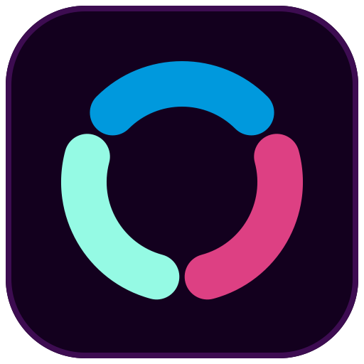

# Colors for Buzz



**Say it with color.**

Controlled lightness, measured contrast, and a whole palette from up to three colors—built in OKLCH and checked with APCA and WCAG.

Choose Dark, Light or Auto. Monochrome takes one color, bichrome two, and
trichrome three. The original plugin ID and preferences stay unchanged.


<details>
<summary>Play the full 46-second introduction</summary>

https://github.com/user-attachments/assets/a42c7ad7-cde1-43d4-a351-2ff9753cb342

</details>

[Download the video (MP4)](https://github.com/bluepinkneon/buzz-chroma/releases/download/v1.3.1/color-overthinkers-intro.mp4) · [Download the poster](https://github.com/bluepinkneon/buzz-chroma/releases/download/v1.3.1/color-overthinkers-poster.png)

A silent tour of character palettes, Mono/Bi/Tri, Light/Dark/Auto, circular hue
rotation, local saves and the live plugin API. The preview uses synthetic content
and the v1.3.1 plugin. The current release refines the character recipes and their
recommended modes; this recording shows the earlier catalog.

## Install

Requires Buzz Desktop with API v1 external-plugin support.

1. Open **Settings → Manage plugins → Add**.
2. Enter `https://github.com/bluepinkneon/buzz-chroma`.
3. Set the branch/reference to **main**, choose **Find**, then select **dist**.
4. Review and install **Colors**, then enable it.
5. Close Settings and open **Colors**, directly below **Inbox**.

On macOS you can open the install review with:

```sh
open 'buzz://plugin-install?repository=bluepinkneon%2Fbuzz-chroma&ref=main&path=dist'
```

### Update an existing GitHub install

Open **Settings → Manage plugins → Colors → Update**. Use the same
repository, reference **main**, and folder **dist**, then **Find → review → Update**.
A GitHub install is pinned to the reviewed commit; pushing here does not hot-reload
an installed copy. The new screen shows **Trichrome / Bichrome / Monochrome** and
**Neon**. Reinstalling an old version tag keeps that old version. For a fixed
release instead, select a version tag from [Releases](https://github.com/bluepinkneon/buzz-chroma/releases).

Or download the folder ZIP from [Releases](https://github.com/bluepinkneon/buzz-chroma/releases),
extract it, and select it with **Add → Browse**. Existing folder installs can
reload the updated source through Manage plugins.

## Character palettes

`blue-pink-neon` is Ranveer’s original. The other 27 are a focused selection of
recognizable characters from comics, film, books and games. Names are readable
and alphabetically sorted in the picker; internal IDs stay in kebab-case.
Saved local themes have their own alphabetically sorted group.

Each character has **one color recipe**, a specific visual reference, and a
recommended appearance and color mode. Ezio starts with white/silver ground and
crimson accents in Light/Bichrome; Batman and Black Widow start in Dark. Selecting
a preset restores that complete recommended look. You can then choose any other
mode or appearance without changing its stored colors.

<details>
<summary>All 28 palettes and their recommended looks</summary>

| Palette | Recommended look | Color idea |
|---|---|---|
| `batman` | dark · bichrome | Charcoal Batsuit with the golden Bat-Signal. |
| `black-panther` | dark · bichrome | T’Challa’s black suit, violet vibranium energy and silver details. |
| `black-widow` | dark · trichrome | Black tactical suit, scarlet hourglass and copper-red hair. |
| `blue-pink-neon` | dark · trichrome | Ranveer’s original: blue, pink and neon. |
| `chun-li` | light · trichrome | Classic blue qipao, gold trim and white boots. |
| `daredevil` | dark · monochrome | Classic crimson suit, charcoal details and silver-white highlights. |
| `darth-vader` | dark · trichrome | Black armor, red lightsaber and silver helmet highlights. |
| `deadpool` | dark · trichrome | Red suit panels, black tactical gear and white eye lenses. |
| `doctor-strange` | dark · trichrome | Blue tunic, red Cloak of Levitation and the golden Eye of Agamotto. |
| `ezio-auditore` | light · bichrome | Brotherhood’s white robes, silver armor and crimson sash. |
| `gandalf` | dark · trichrome | Gandalf the Grey’s wool robes, wooden staff and silver hair. |
| `harley-quinn` | light · trichrome | Modern pink-and-blue hair, pale makeup and black stagewear. |
| `hermione-granger` | dark · trichrome | Black Hogwarts robes with Gryffindor scarlet and gold. |
| `john-wick` | dark · trichrome | Black tailoring with violet and blue Chapter 4 night lighting. |
| `joker` | light · trichrome | Classic purple suit, green hair and chalk-white face paint. |
| `lara-croft` | auto · trichrome | Classic teal top, brown leather and neutral stone. |
| `link` | light · trichrome | Classic green tunic, brown leather boots and a white undershirt. |
| `miyamoto-musashi` | light · trichrome | Sumi ink, pale paper and the warm wood of Musashi’s brushwork. |
| `neo` | dark · monochrome | Matrix phosphor green, black leather and green code. |
| `princess-leia` | light · monochrome | A New Hope’s white gown and silver belt, without invented accents. |
| `samus-aran` | dark · trichrome | Classic Varia armor: orange body, red helmet and green visor. |
| `sekiro` | dark · trichrome | Wolf’s weathered rust coat, charcoal wrappings and steel blade. |
| `sherlock-holmes` | light · monochrome | Victorian sepia, dark ink and pale paper. |
| `spider-man` | dark · trichrome | Classic red-and-blue suit with white eye lenses. |
| `superman` | light · trichrome | Classic blue suit, red cape and yellow S shield. |
| `wolverine` | dark · trichrome | Classic battle yellow, cobalt blue and the red X-Men belt. |
| `wonder-woman` | light · trichrome | Classic crimson armor, royal blue and golden insignia. |
| `zelda` | light · trichrome | The Wind Waker’s pink-and-white royal dress with gold trim. |

</details>

Light and dark solve brightness and contrast from the same seeds. Monochrome is
an intentional one-hue reduction; bichrome derives Neon from two seeds; trichrome
uses all three. Neutral reading surfaces let a black or white outfit retain its
signature accent without tinting the whole app. See the
[character references and curation notes](https://github.com/bluepinkneon/buzz-chroma/blob/main/CHARACTERS.md) for the chosen versions.

Monochrome follows Primary automatically. Pick a custom monochrome hue, or choose
**Monochrome options → Use primary hue** to link it again. An explicit API mode or
appearance overrides a preset’s recommendation.

Existing saved colors are preserved. Re-select a preset to adopt its revised
recipe. Fourteen retired picker entries remain callable by their old API IDs and
in snapshots, so existing integrations keep working.

## Make a palette

- **Trichrome:** choose **Primary**, **Secondary** and **Neon**.
- **Bichrome:** choose **Primary** and **Secondary**; Neon is derived automatically.
- **Monochrome:** choose **Primary** for every decorative family. **Neutral gray** is
  the same mode at zero chroma. Alerts retain familiar signal colors.
- **Hue rotation:** drag the circular dial, or use the arrow keys. Page Up/Down
  moves 15°; Home/End selects 0°/359°. Rotation moves the whole look in every mode. Editing
  a color keeps this angle and leaves unedited colors unchanged.
- A gray pick makes only that family neutral. Two gray bichrome inputs also make
  the derived Neon neutral; one gray input borrows the other input’s hue.
- **Light / Dark:** independently computed surfaces and contrast-checked inks.
- **Auto:** follows Buzz’s resolved appearance, including its System setting and
  OS day/night schedule. It does not impose a sunrise timer or change Buzz’s saved
  preference. If Buzz supplies no resolved mode, it follows the OS directly.
- **Reset:** restores the original colors,
  trichrome mode, rotation, neutral flags, ground relationship and dark appearance.
- **Buzz default** removes the palette override. The Colors icon keeps its
  interface tint while the plugin is enabled; disabling removes both owned styles.

The RGB controls select a hue or a neutral family; the generator owns
lightness and chroma. Their displayed swatches round-trip without hue drift.
Neon supplies the reading-ink tint; its picker shows a hue swatch and the preview
shows the actual ink. Hidden trichrome choices survive a visit to another mode.
In Light mode, ink can approach black when higher contrast requires it.

Danger/removal stays red, success/addition green, and warning amber. Buzz’s diff
viewer consumes those same semantic roles. It has no independent modification
color: modifications are insertion/deletion hunks.

Selected, hovered and pressed states use separate tones. Monochrome selections
also retain an inset stripe; links keep Buzz’s underlines and reactions its rings.
Preferences are local to this device. Older preferences migrate without deleting
the old rollback key.

## See what the controls generate

Controls and the live palette sit side by side in a wide window and stack in a
narrow one. **Rotate +45°** and **Reset** stay visible.

- **Palette:** eight named families, with twelve source shades in each. Hover a
  shade to see its name, index and hex value.
- **Console colors:** all sixteen normal/bright ANSI exports, labeled with names
  and hex values. Buzz 0.7.9 keeps xterm’s ANSI colors; this preview does not set
  its sixteen ANSI colors, indexed colors or explicit RGB escape sequences.
- **Status and diffs:** the actual contrast-solved Buzz success/addition,
  danger/removal, warning and information inks, backgrounds and icon colors.

Primary, Secondary, Neon and Ground follow your inputs through the original
generator; neutral families use the contrast-solved gray ramp. Red, Green, Amber
and Blue keep the original hand-tuned signal snapshot. ANSI magenta/cyan also
retain their original anchors, so monochrome does not merge those named slots.
Buzz UI roles are separately solved for the selected Light/Dark appearance; raw ramps
are not a claim that every shade can be used as text on every background.
Choosing **Buzz default** removes the plugin override and its generated preview.

Buzz’s built-in terminal reads the generated panel, standard text and selection
colors for its background, foreground, cursor and selection. The plugin publishes
those actual values through the root style properties that Buzz watches, so an
already-open terminal refreshes as the palette changes. Original inline values
are restored on Buzz default or disable; another writer’s later values are kept.
See the [host integration audit](https://github.com/bluepinkneon/buzz-chroma/blob/main/INTEGRATION.md)
for the verified connections and limits.

## Save your own themes

Expand **Save your theme**, enter a name, then choose **Save locally**. The name
becomes kebab-case. Saved themes appear in the selector under **Saved on this
device**, and survive app restarts. They restore palette and color-mode settings while
keeping your current Light/Dark/Auto preference. Duplicate names receive a
suffix; built-ins and earlier saves are never overwritten. **Remove saved theme**
removes the local copy and keeps the current colors as an unsaved look.

If the stored library is unreadable, Save/Remove stay locked to protect it. Only
the explicit **Reset local library** button clears those stored bytes.

If saving fails, the library remains usable for the current session and keeps
an unsaved-changes notice visible. A later successful library save writes those
session changes too. If another window changes the stored library, a stale window
refuses to overwrite it; reload the plugin before saving again.

Up to 50 themes are stored in the device’s localStorage. Nothing is uploaded.
Disabling the plugin keeps them; clearing app/site data can remove them.

## Gentle fades and agent expression

Colors can be a subtle companion to a conversation: a calm working atmosphere,
a celebratory moment, a Christmassy palette, or a brief attention cue when an
agent needs your input. Error details still belong in the conversation; color is
an additional expression, not the only message.

One call selects **one look**. For a sequence, the caller sets a look, waits, then
sets the next one. Colors has no background playlist or internal loop. The agent
can save a recipe once and reuse its `local:<name>` ID.

Expand **Color fades** below the controls to preview a preset, choose a duration,
end the preview, or **Keep target look** as your saved choice. Manual edits take
over and invalidate temporary handles. They use the requested target, never an
intermediate animation frame.

A fade follows the shortest circular path for the displayed input hues with
cosine easing. At most twelve samples per second regenerate the complete
contrast-solved palette. Finished CSS colors are never blended independently
of their text. Identical samples are skipped and the generated-role cache is
bounded. The final frame exactly matches an immediate call for the same target.
Mode, appearance and neutral-family/ground changes switch atomically. Reduced
motion or a hidden window finishes the target immediately. Covered older
handles pause until revealed. These are gentle color changes, not a strobe mode.

```js
const live = ctx.chroma.setLook({
  colors: ["#d62828", "#167a43", "#efc66c"],
  mode: "trichrome", appearance: "dark", rotation: 0, fadeMs: 5000,
});
live.update({ rotation: 30, fadeMs: 5000 }); // interrupts from the last painted look
live.transition(); // {status:"fading", fadeMs, elapsedMs, target}, or {status:"idle"}
live.dispose(); // restores the previous live handle or saved user look
```

### Reusable local presets and backup

```js
const result = ctx.chroma.savePreset("christmas", {
  colors: ["#d62828", "#167a43", "#efc66c"],
  mode: "trichrome", appearance: "auto", rotation: 0,
});
// {id:"local:christmas", persisted:true}; false means session-only storage.
const available = ctx.chroma.listPresets({ includeSaved: true });
const live = ctx.chroma.setLook({ preset: result.id, fadeMs: 5000 });
```

Names are kebab-case, at most 60 characters. Creation refuses an existing name,
a built-in name, or a full/locked library; it never overwrites or deletes a
preset. A stale or unreadable storage comparison refuses the write. A quota
failure reports `persisted:false`; it does not claim a durable save. API saves
include the requested appearance; older UI saves retain their original
keep-current-appearance behavior.

**Save your theme → Back up or restore presets** provides JSON export/import.
Save a copy of the JSON somewhere you keep your files. Import validates the
whole library before adding entries and refuses duplicate names. There is no
cloud synchronization. Clearing Buzz’s app data can remove device-local presets.
Older plugin versions may refuse libraries with newly added settings; keep a
backup before downgrading and do not reset a refused library to recover it.

## Tools for agents

The same color controls are exposed as four tools. Their descriptions encourage
subtle expression: mood, focus, celebration, a festive atmosphere, and brief
attention or error cues alongside a clear conversational message.

Open **Colors → Agent expression** to opt in. Both connections start **off** on
an existing installation:

- **Local agents:** Buzz advertises a plugin-owned MCP connection on this
  computer. Agents such as Shepherd discover the tools through Buzz’s bundled
  helper. Other processes running as your OS user can use that connection too.
- **Buzz agents:** adds the four tools to Buzz’s native agent registry. **Buzz
  0.7.9 starts every Codex agent in a fresh thread when tools are added or removed.**
  Enable or disable this between tasks. This is global to Buzz agents, not a
  connection to one selected model.

| Tool | Input | Result |
|---|---|---|
| `chroma_get_look` | `{}` | `{look, palette?}`; generated colors are omitted while Buzz Default is active |
| `chroma_set_look` | Look options with optional `fadeMs`, or `{look: snapshot, fadeMs?}` | `{look, transition}`; applies one temporary look and returns without waiting for the fade |
| `chroma_save_preset` | `{name, look}` | Creates one local preset; reports its ID and whether storage persisted |
| `chroma_list_presets` | `{}` | Built-ins and saved `local:<name>` presets |

`look` cannot be combined with patch fields in the setter. Each transport owns
one live setter handle, replacing it only after the new request validates.
Disabling a connection releases its temporary look. No tool deletes or
replaces a saved preset. Rapid light/dark cuts are rate-limited; a refused call
reports `retryAfterMs`. A fade remains asynchronous, so it does not hold a tool
request open for its duration.

On macOS, with **Let local agents control colors** enabled:

```sh
/Applications/Buzz.app/Contents/Resources/bin/buzz-agent-command tools
/Applications/Buzz.app/Contents/Resources/bin/buzz-agent-command call chroma_get_look '{}'
/Applications/Buzz.app/Contents/Resources/bin/buzz-agent-command call chroma_set_look '{"colors":["#d62828","#167a43","#efc66c"],"mode":"trichrome","appearance":"dark","rotation":0,"fadeMs":5000}'
/Applications/Buzz.app/Contents/Resources/bin/buzz-agent-command call chroma_save_preset '{"name":"christmas","look":{"colors":["#d62828","#167a43","#efc66c"],"mode":"trichrome","appearance":"dark","rotation":0}}'
/Applications/Buzz.app/Contents/Resources/bin/buzz-agent-command call chroma_set_look '{"preset":"local:christmas","fadeMs":5000}'
```

For a brief attention cue, first keep the result of `chroma_get_look`, choose a
look, wait in the agent, then restore with
`chroma_set_look({look: previous.look, fadeMs: 2000})`. The same pattern can build
a sequence of festive presets; no sequence engine or LLM runs inside Colors.
Your manual color controls cancel temporary handles. Brightness, contrast and
protected signal colors continue to be generated by the same engine.

Buzz owns the local server, authorization and helper advertisement. The plugin
stores only the two opt-in booleans, never connection credentials. Sharing ends
when disabled, unloaded, or Buzz quits. The helper requires loopback access;
agent sandboxes that block local network access cannot reach it. This connection
is separate from Buzz’s external-app read/post approval.

## Callable API for other Buzz plugins

This is an in-process Cordis service named **chroma**, not an HTTP endpoint.
Require it with `export const inject = ["chroma"]`, then use `ctx.chroma`.
The service has `version: 1` and five methods:

| Method | Returns | Effect |
|---|---|---|
| `listPresets({ includeSaved = false } = {})` | A fresh array of built-in recipes, optionally including local saves | No changes |
| `getLook()` | A fresh snapshot of the current requested look (the target during a fade) | No changes |
| `generateTheme(options = {})` | `Record<string, "#RRGGBB">` containing Buzz semantic CSS roles | Generates only; does not apply or save |
| `setLook(options)` | A callable live handle with `update(patch)`, `transition()` and `dispose()` | Applies or fades to one temporary look; does not save |
| `savePreset(name, look)` | `{ id: "local:<name>", persisted: boolean }` | Creates a local preset without applying it |

Each new `setLook` and `generateTheme` request starts from the **saved user look**
for omitted fields, independently of other temporary handles. A handle’s
`update` starts from that handle’s own target while a fade is running, or its current state otherwise. To deliberately copy the active temporary look’s requested settings, pass
`getLook()` as a complete snapshot.

### Write a consumer plugin

1. Install and enable **Colors** first. Its **Colors** page below
   Inbox is where you choose the saved look; other plugins use the service below.
2. Create a folder containing these two files. Use a different manifest ID from
   Colors so Buzz installs it as a separate plugin.

`manifest.json`:

```json
{
  "id": "example.chroma-demo",
  "name": "Chroma API Demo",
  "description": "Try a temporary palette through Colors.",
  "apiVersion": 1
}
```

`plugin.js` (complete module; no runtime imports):

```js
export const inject = ["chroma"];
export function apply(ctx) {
  const current = ctx.chroma.getLook();
  const palettes = ctx.chroma.listPresets();
  const roles = ctx.chroma.generateTheme(current);
  // roles["--text-standard"] is a hex color for a generated preview.
  // palettes contains the stable IDs accepted by preset below.

  ctx.effect(() => {
    const live = ctx.chroma.setLook({
      preset: "john-wick",
      appearance: "auto",
      mode: "trichrome",
    });
    // An event handler can update this same handle without stacking overrides:
    live.update({ mode: "bichrome", colors: ["#0099dd", "#dd4083"] });
    live.update({ rotation: 45 });
    return () => live.dispose();
  });
}
```

3. In Buzz, choose **Settings → Manage plugins → Add → Browse**, select your
   folder, then review and install it. Enabling this demo applies John Wick,
   then switches to bichrome with two custom colors and rotates it 45°. Disabling the demo disposes its
   handle and restores the previous live look or saved look. No preferences
   are saved by these calls.

Keep every live handle inside a plugin-owned `ctx.effect` and dispose it during
cleanup. For UI that should follow the currently applied theme, use Buzz tokens
such as `style: { color: "var(--text-standard)", background: "var(--surface-panel)" }`;
they update with the theme without copying a stale generated snapshot.
Use `generateTheme` when you need a separate palette preview or color values.
For pages, React, events and packaging, see the official
[Buzz plugin authoring guide](https://github.com/block/buzz-app/blob/main/docs/plugin-authoring-guide.md).

### Options and precedence

| Option | Values / behavior |
|---|---|
| `preset` | A built-in or `local:<name>` ID. Built-ins restore their recommended look; API-saved local presets restore their stored appearance too. Legacy IDs remain accepted. |
| `mode` | `monochrome`, `bichrome`, `trichrome`. Snapshot IDs `mono`, `duo`, `color` also work; `dichrome` aliases bichrome. |
| `colors` | Six-digit hex inputs: one for monochrome, two for bichrome, three for trichrome. All modes also accept a complete three-seed array. |
| `rotation` | Any finite number, normalized to a whole degree modulo 360. |
| `fadeMs` | `setLook`/`update` only: `0` for an immediate change, or an integer from `1000` to `300000` for a finite fade. Default `0`. |
| `appearance` | `dark`, `light`, `auto`. Auto follows Buzz’s resolved mode, with an OS fallback. |
| `monochrome` | A single hex override that enters monochrome. Do not combine it with an explicit non-mono mode. If `colors` is also supplied, it must be the full three-seed array. |
| `surfaceOffset` | `0` for a primary-colored ground, `90` for the original quarter-wheel ground. Omitted values keep the base recipe. |
| `neutralGround` | Boolean. Keeps generic reading surfaces and standard hairlines neutral while Primary actions and Secondary own messages retain their hues. Monochrome ignores it. Omitted values keep the base recipe. |

A preset is applied first, then explicit options override it. RGB inputs choose
a hue or neutral family, not exact output brightness. Without an explicit
`rotation`, colors render as picked and the current angle is kept. With an
explicit `rotation`, supplied colors are base hues under that angle. Only supplied
seeds change; hidden trichrome choices and custom monochrome choices are kept.
A three-seed array changes the stored seeds; a custom monochrome override stays
active until replaced, **Use primary hue**, reset, or a new preset selection.

```js
const cssRoles = ctx.chroma.generateTheme({
  mode: "bichrome", colors: ["#cc2233", "#3355ff"], appearance: "light",
}); // colors only; nothing applied
const live = ctx.chroma.setLook({ mode: "monochrome", colors: ["#cc2233"] });
live.update({ appearance: "light" }); // returns undefined
live.dispose();                     // returns undefined; idempotent
// live() is the equivalent callable cleanup form.
```

The newest **live handle by creation order** wins. Updating an older handle does
not raise its priority. Disposing a middle handle leaves the newest unchanged;
disposing the newest reveals the previous live handle, then the saved user look.
A UI change takes ownership: it saves the requested target with the person’s edit (the visible look when no fade is running),
cancels all temporary handles, and prevents old handles from being revived.
`update` on a disposed/cancelled handle throws. Disabling the provider removes
its service and deactivates consumers that require it; it does not uninstall them.
All five methods throw after disable; old disposers remain harmless.

All API inputs are validated. Unknown fields, unsupported modes, malformed colors,
non-finite angles and conflicting options throw before changing the look. Returned
arrays/objects and accepted snapshots are isolated from caller mutation. External
look overrides never write preferences or the local theme library; `savePreset` is the explicit create-only library operation.

### Snapshot and preset records

`getLook()` returns these settings and derived metadata:

| Fields | Meaning |
|---|---|
| `theme` | `bluepinkneon` or `default` (Buzz’s own appearance) |
| `hues`, `rotation`, `neutrals` | Three stored seed angles, shared rotation, and per-seed neutral flags |
| `mode` | Stable snapshot ID `color`, `duo` or `mono` |
| `monoHue`, `neutral` | Optional unrotated mono override (`null` links Primary), and neutral-gray choice |
| `appearance`, `surfaceOffset`, `neutralGround`, `localName` | Appearance preference, ground relationship, neutral-ground flag, saved local name or `null` |
| `preset` | Underlying recipe ID at zero rotation, or `custom`; it identifies palette seeds, not the selected mode |
| `effectiveHues`, `effectiveNeutrals` | Three resulting hues and neutral flags after mode/rotation derivation; hue is irrelevant for a neutral family |
| `resolvedAppearance` | Last applied `dark` or `light` appearance |

`getLook()` returns the requested destination while a fade runs. Save/restore
therefore keeps the intended look instead of accidentally adopting a halfway
frame. The painted palette moves toward that destination. Use Buzz CSS variables
for visuals that should track every painted sample; `generateTheme(getLook())`
generates the destination palette during a fade.

Complete snapshots replace settings and can round-trip through `setLook` or
`live.update`. Derived metadata is shape-checked, then ignored and recomputed;
it never overrides the stored settings. `generateTheme` always generates the
plugin palette, even from a `theme: "default"` snapshot; it does not introspect
Buzz’s own theme. It returns only semantic CSS roles, not a CSS string, source
ramps, ANSI exports or solver measurements.

```js
const snapshot = ctx.chroma.getLook();
const live = ctx.chroma.setLook(snapshot); // exact same palette
live.update({ mode: snapshot.mode });     // snapshot IDs also work in patches
live.dispose();
```

Each `listPresets()` entry contains `id`, `description`, three `hues`, three
`neutrals`, `surfaceOffset`, `neutralGround`, `defaultMode` (`color`/`duo`/`mono`),
`defaultAppearance` (`dark`/`light`/`auto`) and `defaultNeutral` (currently always `false`). Mutating the returned catalog never changes built-ins.
The API grants no messages, account, filesystem or network access. Buzz plugins
share a trusted JavaScript context; the service is not a security sandbox.

## Math and checks

```sh
npm run check
```

Python 3, npm, Node.js 24+ and Bun 1.3.14 build one self-contained browser module.
The build verifies the pinned original generator and CSS snapshot by SHA-256,
uses culori 4.0.2 in an automatically removed temporary directory, and checks in
the result under `dist/`. Installers do not need build tools.

Tests cover all 360 hue positions in trichrome, bichrome and monochrome, both appearances,
neutral families, neutral-ground schemes, independent hue combinations, the circular seam, picker
round-trips, storage migration, Auto changes, callable-service custody and cleanup.
The host text/background graph also samples animated highlight composites.
An independent host audit adds call/inverse and switch states, Todo/presence
icons, self-tinted availability labels, and categorical GitHub icons. ANSI tests
compare named slots across all presets, modes and sampled rotations; the host
integration audit separately checks where those values are actually consumed.
Every visible character is also checked in all three modes and all three appearance
preferences, including both Auto outcomes. Sourced color-family briefs check the
rendered signature colors; reference images and rendered contact sheets guide the
aesthetic review rather than arbitrary hue-spacing or catalog-uniqueness rules.
See [ALGORITHM.md](https://github.com/bluepinkneon/buzz-chroma/blob/main/ALGORITHM.md) for the constraints, numeric floors and limits.

- `runtime.js`: controls, validated preferences, lifecycle and callable service.
- `copy.json`: introduction shared with the manifest, Colors page and README.
- `role-engine.js`: polarity-aware contrast solving and gamut mapping.
- `role-map.js`: Buzz semantic role mapping and monochrome state cues.
- `presets.js`: original character-inspired recipes.
- `local-themes.js`: bounded local palette snapshots and names.
- `harmony.js`: periodic two-input Neon derivation.
- `palette-preview.js`: labeled palette, console and semantic-color previews.
- `sidebar-icon.js`: scoped monochrome icon rendering across Buzz versions.
- `terminal-theme.js`: owned root values for Buzz’s terminal refresh observer.
- `palette-transition.js`: a short, owned commit guard against polarity flashes.
- `colors-page.css`: responsive controls and live-palette layout.
- `vendor/bluepinkneon/`: unchanged original generator with hash provenance.
- `shepherd-theme.css`: original 152-color snapshot.
- `test/role-graph.json`: original graph from Buzz main `067db608`, with added
  consumer contexts independently verified at desktop 0.7.9 `8ad11326`.

## Icon source

Both icon sizes use **icon.svg** as the single glyph source. The sidebar embeds
that SVG and follows the text color. The packaged PNG is rendered from it
at 512px in neutral gray `#8a8a8a`, on a transparent background.
`tools/render-icon.html` renders the PNG using browser Canvas 2D;
`icon.provenance.json` records the renderer/version and source/output hashes.
The build verifies those hashes so the two assets cannot drift silently.

## Changes in v1.5.0

- Four opt-in agent tools for reading, applying, saving and listing looks. Their
  descriptions explain colors as subtle mood and attention cues.
- Finite input-hue fades through the existing contrast solver, interruption from
  the last painted look, reduced-motion handling, and manual takeover.
- API access to local presets plus validated JSON backup/import. API saves retain
  appearance; existing UI saves keep their previous behavior.
- Saved palette colors, character recipes and protected signal anchors are unchanged.

## Changes in v1.4.1

- Rebalanced Spider-Man: charcoal webbing ground, red controls and blue own-message
  accents, with neutral reading ink. One suit color no longer fills the canvas.
- Wonder Woman and Joker recommend Light to show their signature colors together.
  Other modes and appearances remain available from the same color recipes.
- A modeled color-presence regression complements the contrast checks. Re-select
  a preset after updating to adopt its revised recommendation.

## Changes in v1.4.0

- Re-curated 28 recognizable character looks against specific outfit/art references.
  Ezio uses white/silver and red; extraneous mint, violet and gold accents are removed
  where the character does not support them.
- Presets now include a recommended Light/Dark/Auto appearance as well as a color
  mode. Explicit API options still win; saved local themes keep your current appearance.
- Neutral-ground recipes separate the outfit’s neutral base from its signature accent
  through the same gamut and contrast engine. Original Blue Pink Neon is unchanged.
- All mode/appearance combinations are checked from one shared recipe. Retired
  preset IDs and existing saved colors remain supported.

## Changes in v1.3.2

- Alphabetical, title-cased theme labels in the picker. Internal IDs, saved keys
  and API values keep their original kebab-case names.
- Saved local themes use the same readable labels and sort within their group.
- A complete two-file consumer-plugin example, with service access, live updates
  and cleanup, complements the API reference.

## Changes in v1.3.1

- A circular hue dial with pointer/touch dragging and keyboard control.
- Compact labeled source ramps, ANSI exports and status tiles fit above the
  fold in a desktop content area of 1024×760 or larger; smaller windows stack.
- `sekiro` and `ezio-auditore` join the catalog. Preset labels use kebab-case.

## Changes in v1.3.0

- Responsive two-column settings with sticky controls and a live palette;
  visible rotation/reset actions, plus narrow-window stacking.
- Independent audits of actual Buzz 0.7.9 consumers: local light/dark islands,
  legacy aliases, terminal refresh, raised composers, calls, switches, presence
  and Todo states. The expanded role graph checks these real contexts.
- Brighter dark-mode prominent controls with dark ink, so inverse labels and
  incoming-call decisions retain contrast; light mode keeps dark fills/light ink.
- Stable named ANSI colors through every color mode and rotation. These are
  exports, not a replacement for Buzz’s xterm ANSI configuration.
- Slightly separated `black-widow`, `motoko-kusanagi` and `ahsoka-tano` recipes to keep the catalog
  distinguishable after the strong-control correction.

## Changes in v1.2.3

- A simple palette glyph with three “thinking…” paint dots, shared by sidebar,
  plugin card and details header while enabled.
- Buzz 0.7.9 uses a generic icon for external plugins. A narrowly scoped,
  lifecycle-owned compatibility style replaces only our own card/details glyph.
  It uses that host’s verified data/ARIA hooks; it is not a public host icon API.
  Disabling the plugin restores Buzz’s placeholder. Filtering our row out can
  also restore the details placeholder.
- The technical introduction now appears after the tagline in Buzz’s plugin
  description as well as the Colors page and README.

## Changes in v1.2.2

The packaged glyph and **Colors** sidebar share the same palette source.
Buzz’s external-plugin card still uses its generic icon in this version.
The monochrome sidebar icon also follows the text color on older Buzz versions
that render page icons as images. Its scoped icon style stays active with Buzz’s
default theme and is removed when the plugin is disabled. Other icons are untouched.

## Changes in v1.2.1

- Color edits keep the rotation angle; colors-only API calls no longer reset it
  to zero. Hidden seeds and monochrome overrides no longer drift during edits.
- New live handles start from the saved user palette instead of inheriting a
  different plugin’s temporary override.
- Snapshot IDs work in mode patches; snapshots own their arrays; ambiguous input
  combinations are rejected; derived neutral flags are available in snapshots.
- Failed library saves remain visibly unsaved; stale windows refuse to overwrite
  another window’s saved themes. Future built-in names cannot lock local saves.
- A theme-colored SVG outline in the sidebar and a packaged transparent plugin
  icon. Released Buzz hosts showed a generic external-plugin details icon;
  version 1.2.3 added the scoped enabled-plugin compatibility treatment.
- Cleaner pickers/rotation, labeled palette and console previews, and current API
  reference and GitHub update instructions.

Versions before 1.4.0 do not accept `neutralGround` in local-library entries.
A downgrade may refuse that library and lock writes; do not reset it to downgrade.
Upgrade forward to read it again.

Version 1.1.0 cannot read bichrome settings in the v3 preference key; downgrading
falls back to its default palette. Upgrade forward for all three modes. Older v2
preferences remain untouched for rollback.

## Compatibility and license

This is an opt-in CSS color override, not a Buzz core change. Buzz keeps its
spacing, typography and layout. New host roles may require updates; contrast
checks cover the documented graph, not every future plugin or arbitrary CSS.
The code makes no network requests. It saves only namespaced theme preferences
under `com.ranveer.bluepinkneon:theme:v3` and a bounded local library under
`com.ranveer.bluepinkneon:presets:v1`. External plugins are reviewed by Buzz.

MIT. The original palette generator is published by its owner. Bundled culori
is MIT; its notice is included. Independent plugin, without marketplace endorsement.
